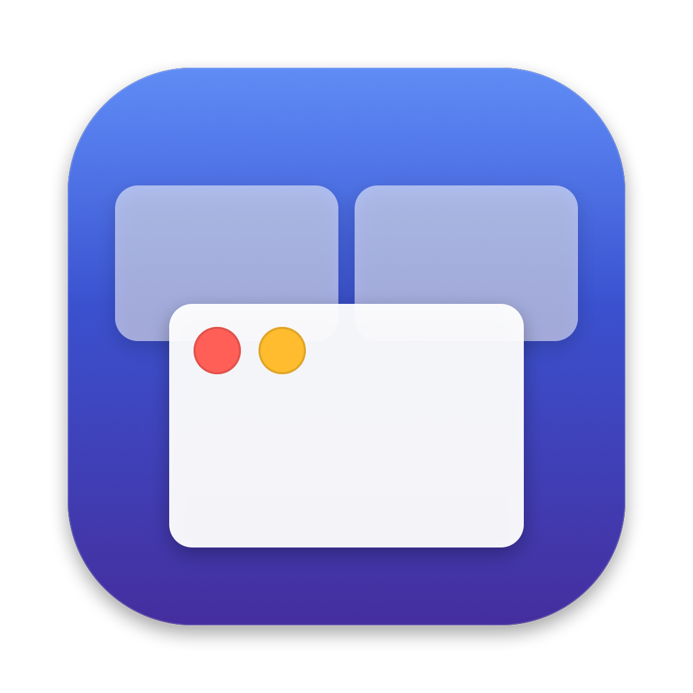
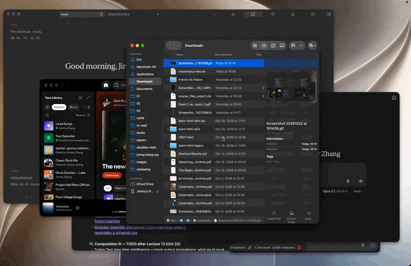

<p align="center">
  
</p>

<h1 align="center">Mission Plus</h1>

<p align="center">
  Close, minimize and keyboard-drive your windows from Mission Control.<br>
  Free and open source.
</p>

<p align="center">
  <a href="https://github.com/j1mmy2hang/mission-plus/releases/latest/download/MissionPlus.dmg"><b>Download for macOS</b></a>
</p>

<!-- Demo: add a short screen recording as docs/demo.gif and uncomment.
<p align="center"></p>
-->

## What it does

**Buttons in Mission Control.** Open Mission Control as usual and hover a window: close and minimize
buttons appear on it, styled like macOS's own traffic lights.

**Shortcuts in Mission Control.** Act on the highlighted window without leaving Mission Control:

| Key | Action |
|---|---|
| ⌘W | Close the window |
| ⌘M | Minimize the window |
| ⌘H | Hide its app |
| ⌘Q | Quit its app |
| ⌥⌘W / ⌥⌘M | Close / minimize all windows |
| ⌥⌘H | Hide every other app |
| ⌃⌘F | Open the window in full screen |
| ← → ↑ ↓ | Move between windows |
| ↵ | Open the window |
| Middle-click | Close the window |

Each shortcut can be switched off in Preferences.

**Window Overview.** A Mission Control–style overview of every window on the current Space, with live
thumbnails and the same buttons and shortcuts, plus type-to-search. Open it with ⌃⌥↑ (or a shortcut of
your choice), or let it take over the three- or four-finger swipe up. Mission Control stays on ⌃↑ and F3.

## Install

1. [Download Mission Plus](https://github.com/j1mmy2hang/mission-plus/releases/latest/download/MissionPlus.dmg),
   open it, and **drag Mission Plus to Applications**. Run it from there: macOS won't let an app
   update itself from the disk image or Downloads.
2. Open Mission Plus and grant the two permissions it asks for in **System Settings › Privacy & Security**:
   - **Accessibility**, to close, minimize and focus windows and to read Mission Control.
   - **Screen Recording**, for the overview's live thumbnails. Without it, app icons are shown instead.

Mission Plus lives in the menu bar. It checks for updates once a day and asks before installing one.

**Requirements:** macOS 14 or later. Developed and tested on macOS 27. The Mission Control buttons rely
on how recent versions of macOS build Mission Control (see below) and may not appear on older versions;
the Window Overview works everywhere.

## Privacy

Everything happens on your Mac. Window thumbnails are captured in memory, shown, and never saved or
sent anywhere. The only network request Mission Plus makes is its daily update check, which reads
[`appcast.xml`](appcast.xml) from this repository.

## How it works

On recent macOS, Mission Control is drawn by `WindowManager.app`, which describes it to Accessibility:
each thumbnail is a button carrying the ID of the window it shows. Mission Plus reads those buttons'
positions, draws its own buttons in a transparent, click-through window above them, and handles clicks
and keys with an event tap while Mission Control is open. Nothing is injected into other apps or the
system, but this does depend on undocumented details Apple could change in a future update, and on one
long-standing private function (`_AXUIElementGetWindow`, used by most window managers) to match
windows to their IDs.

The overview is Mission Plus's own: live thumbnails come from ScreenCaptureKit, and windows are
closed, minimized and focused through the Accessibility API. The swipe takeover intercepts the system's
dock-swipe gesture events only when you turn it on.

## Build from source

Requires Xcode 26 or later.

```sh
git clone https://github.com/j1mmy2hang/mission-plus.git
cd mission-plus
./build.sh --run
```

`build.sh` signs with your Apple Development certificate if you have one, so macOS remembers the
permissions across rebuilds; otherwise it signs ad hoc, and you'll need to grant them again after each
build. To regenerate the icon, run `swift scripts/make-icon.swift`.

## Releasing

For maintainers. Write the notes under `## <version>` in [CHANGELOG.md](CHANGELOG.md), commit, then:

```sh
scripts/release.sh build 1.1.0     # version, build, notarise, package, add to appcast — all local
scripts/release.sh publish 1.1.0   # push the tag, create the GitHub release, put the appcast live
```

Once-only setup is listed at the top of [`scripts/release.sh`](scripts/release.sh). Two things must
never change once a version has shipped, because every installed copy has them built in: the feed URL
(`SUFeedURL`) and the Sparkle signing key (`SUPublicEDKey`, whose private half lives in the maintainer's
Keychain).

## Credits

Inspired by [Mission Control Plus](https://www.fadel.io/missioncontrolplus) by Fadel, a paid app
that pioneered this idea. Mission Plus is an independent, open-source project and isn't affiliated
with it. Updates are delivered by [Sparkle](https://sparkle-project.org).

## License

[MIT](LICENSE) © 2026 Jimmy Zhang
